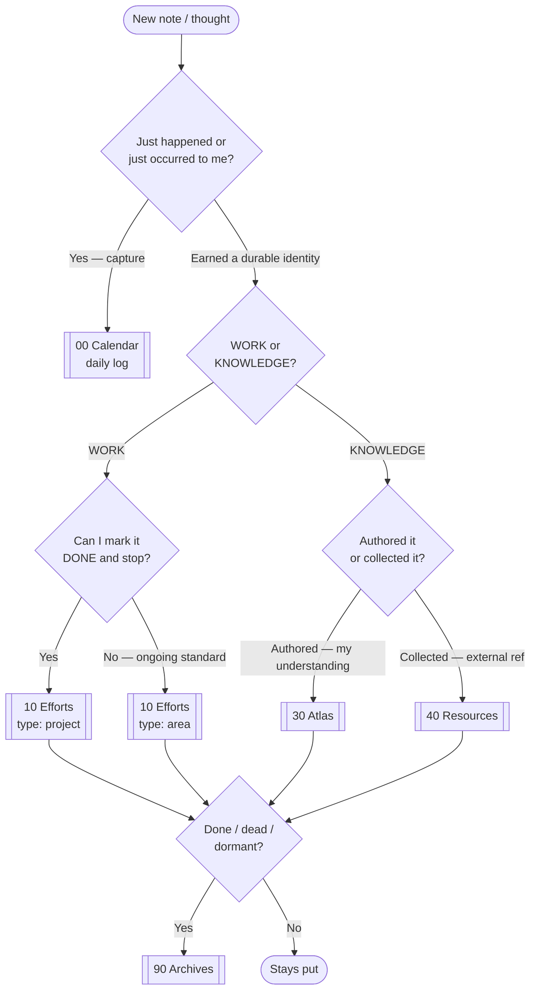

# 🧭 Filing Rules — the AIOS decision procedure

The goal: **never stall on "where does this go?"** Two axes, three yes/no questions,
first-YES-wins. When in doubt, the rules below break every tie deterministically.

## The two axes
- **Axis 1 — WORK vs KNOWLEDGE.** Something I *do / am accountable for*, vs something I *know / collected*. Deciding this first means the two classic PARA gray zones (Area↔Resource, Project↔Resource) can never form — they sit on opposite sides.
- **Axis 2 — the split inside each side** (one clean question each, below).

## The cascade (first YES wins)
| #   | Question (objective)                                     | Goes to                        |
| --- | -------------------------------------------------------- | ------------------------------ |
| 0   | Just happened / just occurred to me?                     | `00 Calendar` (daily log)      |
| 1   | **WORK** — can I mark it **DONE** and stop?              | `10 Efforts` · `type: project` |
| 2   | **WORK** — ongoing **standard I maintain**, no end?      | `10 Efforts` · `type: area`    |
| 3   | **KNOWLEDGE** — I **authored** it (my understanding)?    | `30 Atlas`                     |
| 4   | **KNOWLEDGE** — I **collected** it (external reference)? | `40 Resources`                 |
| 5   | Done / dead / dormant? (lifecycle, not a category)       | `90 Archives`                  |

## The bright lines (not vibes)
- **Project vs Area** → *Does a done-state exist?* Finish and stop = project. Maintain forever = area. (In AIOS these share the `10 Efforts` folder — the distinction is the `type` field, so a change is a one-field edit, never a file move.)
- **Atlas vs Resources** → *Did I write it or collect it?* My words/synthesis = Atlas. Someone else's material = Resources.
- **Work vs Knowledge** → *Something to do/uphold, or something to know?*
- **Snapshot vs Living note** → *Does it carry `date:` or `created:`?* `date:` = a fixed record of a moment, never retro-edited. `created:` = a projection of now, never allowed to go stale. See [[Conventions]] § ⏳ Snapshots vs Living Notes.

## The two rules that kill decision fatigue
1. **One door for capture.** Never file at capture — everything lands in the daily log. Promote to a folder *later*, and only if the note earns a durable identity. "I don't know yet" is a permanent, valid state.
2. **Folders are weak; `type` + `[[links]]` are strong.** You retrieve by search, links, and Dataview — not by browsing folders. So a misfile costs nothing. Low stakes = no agonizing.

## Tie-breakers
- Torn between Work and Knowledge → **it's Knowledge** (Work has crisp tests; Knowledge is the residual).
- Torn between Atlas and Resources → **Atlas if any of your own words are in it**, else Resources.
- Still torn → **leave it in the log.** You are never forced to choose.

## Decision flowchart

